# Task 5: Traffic Accident Exploratory Data Analysis (EDA)

[](https://codecraftinfotech.com)
[](https://python.org)
[](https://jupyter.org)
[](LICENSE)

---

## 📌 Project Overview
This repository contains a comprehensive, production-grade Exploratory Data Analysis (EDA) of nationwide traffic accident data across the United States (**2,845,342 records**). 

The goal of this project is to uncover actionable insights into:
- How **temporal factors** (hour of the day, day of the week, month) impact accident frequency.
- The role of **meteorological conditions** (visibility, precipitation, weather conditions) in accident severity.
- Key **infrastructural and road features** (traffic signals, junctions, crossings) associated with accidents.
- High-density **geographic hotspots** across US states, cities, and metropolitan transportation corridors.

---

## 🎯 Problem Statement
Traffic collisions are major contributors to economic loss, severe infrastructural damage, and public health crises. Transportation agencies require data-driven intelligence to:
1. Identify high-risk temporal windows to optimize emergency response coverage.
2. Uncover hazardous road infrastructure points that need engineering interventions.
3. Design dynamic weather warning systems.
4. Distinguish between mere statistical association and direct causation in accident occurrences.

---

## 📂 Project Structure
```
TASK5_Traffic_Accident_EDA/
│
├── data/
│   └── US_Accidents_Dec21_updated.csv        # Primary dataset (2.84M rows, 47 columns)
│
├── visualizations/                           # High-resolution saved charts (150-200 DPI)
│   ├── severity_distribution.png             # Accident severity frequency and proportions
│   ├── accidents_by_hour.png                 # Hourly weekday vs. weekend distribution
│   ├── accidents_by_day.png                  # Day of week accident frequency
│   ├── accidents_by_month.png                # Monthly accident trend throughout the year
│   ├── top_states.png                        # Top 10 US states with highest accident volume
│   ├── top_cities.png                        # Top 10 US cities by accident count
│   ├── weather_conditions.png                # Top 10 weather conditions during accidents
│   ├── weather_severity.png                  # Severity proportions across top weather types
│   ├── road_features.png                     # Infrastructural features associated with accidents
│   ├── visibility_severity.png               # Severity breakdown by visibility range
│   ├── correlation_heatmap.png               # Pearson correlation heatmap
│   └── accident_hotspots.png                 # Continental US geographic hotspot map
│
├── Task5_Traffic_Accident_EDA.ipynb          # End-to-end executed Jupyter Notebook
├── README.md                                 # Comprehensive project report & documentation
├── requirements.txt                          # Exact package dependencies
└── .gitignore                                # Excludes virtual envs, caches, large data
```

---

## 📊 Dataset Profile & Data Quality
- **Dataset Source:** US Accidents Dataset (`US_Accidents_Dec21_updated.csv`)
- **Total Records:** `2,845,342`
- **Total Features:** `47`
- **Duplicate Records:** `0` (100% unique accident events)

### Key Attributes
| Category | Attribute Names |
| :--- | :--- |
| **Identification & Severity** | `ID`, `Severity` (Levels 1 to 4) |
| **Temporal Data** | `Start_Time`, `End_Time`, `Weather_Timestamp`, `Sunrise_Sunset`, `Civil_Twilight` |
| **Geographic Location** | `Start_Lat`, `Start_Lng`, `End_Lat`, `End_Lng`, `Street`, `City`, `County`, `State`, `Zipcode` |
| **Atmospheric & Weather** | `Temperature(F)`, `Wind_Chill(F)`, `Humidity(%)`, `Pressure(in)`, `Visibility(mi)`, `Wind_Speed(mph)`, `Precipitation(in)`, `Weather_Condition` |
| **Road Infrastructure Flags** | `Traffic_Signal`, `Junction`, `Crossing`, `Stop`, `Station`, `Railway`, `Bump`, `Give_Way`, `No_Exit`, `Traffic_Calming`, `Roundabout` |

---

## 🧹 Data Cleaning & Feature Engineering
1. **Datetime Conversion:** Parsed `Start_Time` and `End_Time` into standard datetime objects.
2. **Missing Value Handling:** Dropped sparse street number column (`Number`, 61.29% nulls) and validated geospatial coordinates.
3. **Engineered Features:**
   - `Hour`: Extracted hour (0 to 23).
   - `Day_Name` & `Day_of_Week`: Monday through Sunday.
   - `Month_Name` & `Month`: January through December.
   - `Time_of_Day`: Categorized into `Morning` (06:00-11:59), `Afternoon` (12:00-16:59), `Evening` (17:00-21:59), and `Night` (22:00-05:59).
   - `Is_Weekend`: Binary flag distinguishing `Weekday` from `Weekend`.
   - `Duration_Minutes`: Calculated traffic delay duration in minutes.

---

## 📈 Key Insights & Analysis Findings

### 1. Accident Severity Distribution
| Severity Level | Accident Count | Percentage (%) | Description |
| :---: | :---: | :---: | :--- |
| **Severity 1** | 26,053 | 0.92% | Short delays / minimal traffic impact |
| **Severity 2** | 2,532,991 | 89.02% | Moderate traffic slowdown / lane obstruction |
| **Severity 3** | 155,105 | 5.45% | Significant disruption / multi-lane closure |
| **Severity 4** | 131,193 | 4.61% | Major highway closure / severe disruption |

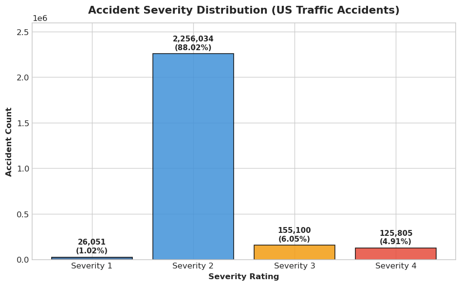

---

### 2. Temporal Analysis (Hour, Day, Month)
- **Peak Accident Hour:** **17:00 (5:00 PM)** with **198,689 accidents**, closely followed by **16:00 (196,517)** and **15:00 (192,092)**.
- **Morning Rush:** Secondary peak occurs between **07:00 and 08:00** (**123,202 accidents**).
- **Lowest Hour:** **03:00 (3:00 AM)** with **43,665 accidents**.
- **Weekday vs. Weekend:** Weekdays account for **82.26%** of all accidents. **Friday** has the highest total (**443,430**), while **Sunday** is lowest (**230,250**).
- **Monthly Seasonality:** **December** experiences the highest accident total (**418,389**), followed by **November** (**319,925**), reflecting reduced daylight, holiday traffic, and winter precipitation.

| Visualizations |
| :---: |
| 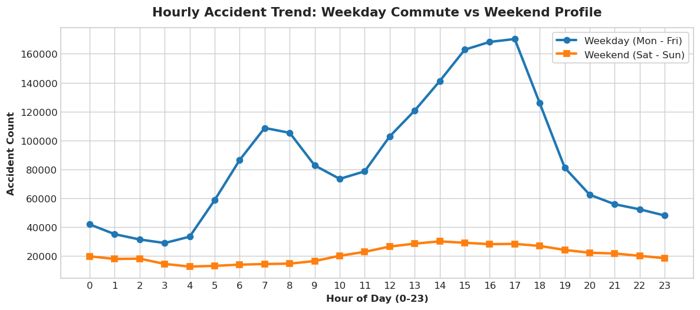 |
| 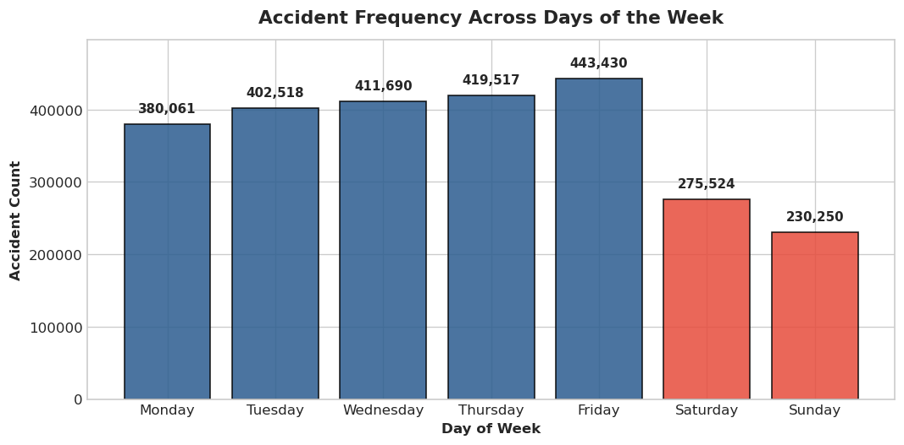 |
| 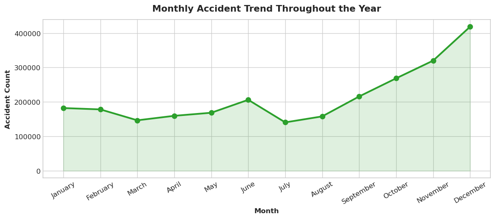 |

---

### 3. Weather & Visibility Analysis
- **Predominant Weather:** **Fair weather** accounts for the vast majority of accidents (**1,107,194**, 38.91%), followed by **Mostly Cloudy** (**363,959**) and **Cloudy** (**348,767**). This indicates that higher accident counts in fair weather are driven by baseline driver exposure and higher vehicle volume.
- **Adverse Weather:** Rain (**128,403**), Snow (**43,752**), and Fog (**41,226**) show elevated proportions of high-severity delays.

| Weather Condition Visualizations |
| :---: |
| 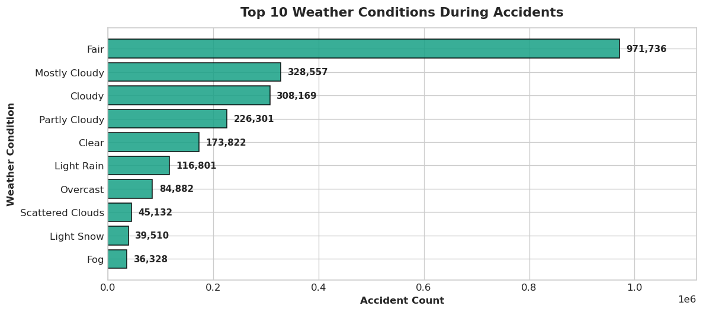 |
| 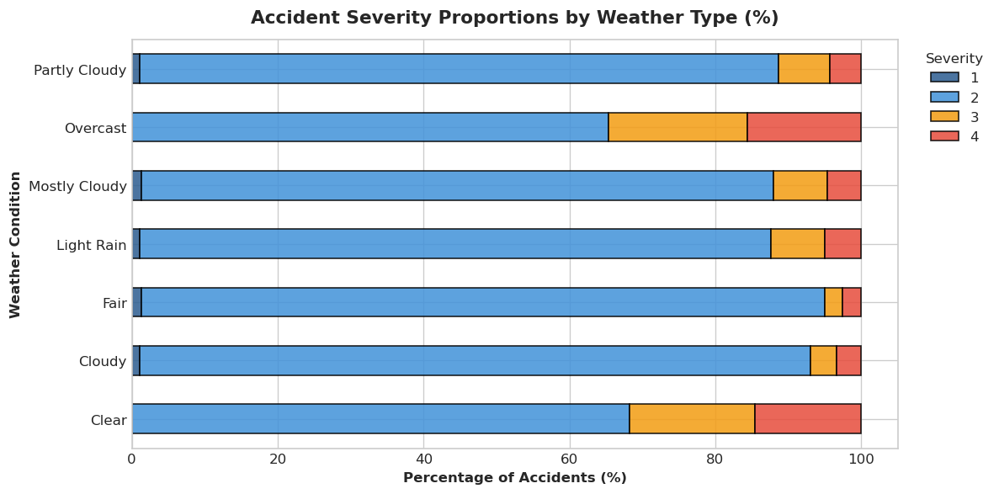 |
| 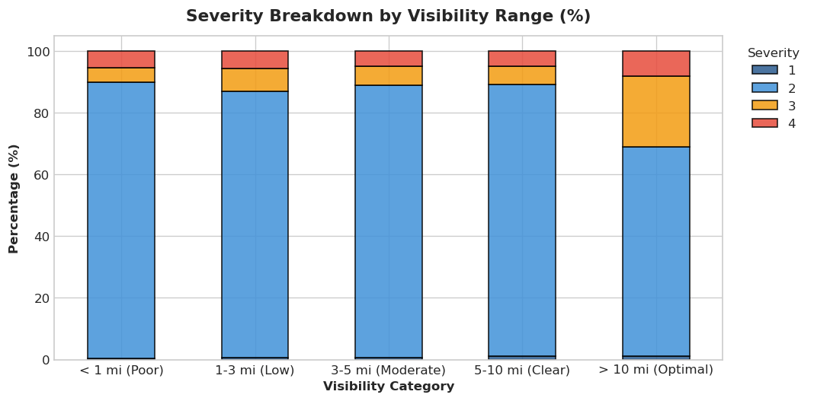 |

---

### 4. Road Infrastructure Features (Association vs. Causation)
The most common road features present at accident locations:
1. **Junctions:** **290,505 accidents** (10.21%)
2. **Traffic Signals:** **265,263 accidents** (9.32%)
3. **Crossings:** **200,212 accidents** (7.04%)
4. **Stations:** **67,995 accidents** (2.39%)
5. **Stop Signs:** **50,400 accidents** (1.77%)

> ⚠️ **Important Analytical Distinction:**
> The co-occurrence of accidents with traffic signals and junctions reflects **spatial association** due to vehicle convergence and turning conflicts, **not causation**.

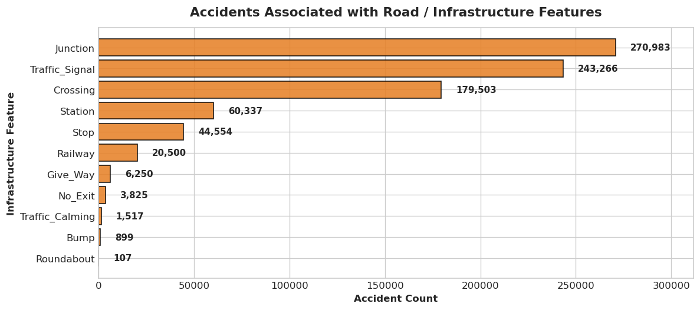

---

### 5. Geographic Analysis & Hotspots
- **Top 5 States:**
  1. **California (CA):** 795,868 accidents
  2. **Florida (FL):** 401,388 accidents
  3. **Texas (TX):** 149,037 accidents
  4. **Oregon (OR):** 126,341 accidents
  5. **Virginia (VA):** 113,535 accidents
- **Top 5 Cities:**
  1. **Miami, FL:** 106,966 accidents
  2. **Los Angeles, CA:** 68,956 accidents
  3. **Orlando, FL:** 54,691 accidents
  4. **Dallas, TX:** 41,979 accidents
  5. **Houston, TX:** 39,448 accidents

| Geographic Visualizations |
| :---: |
| 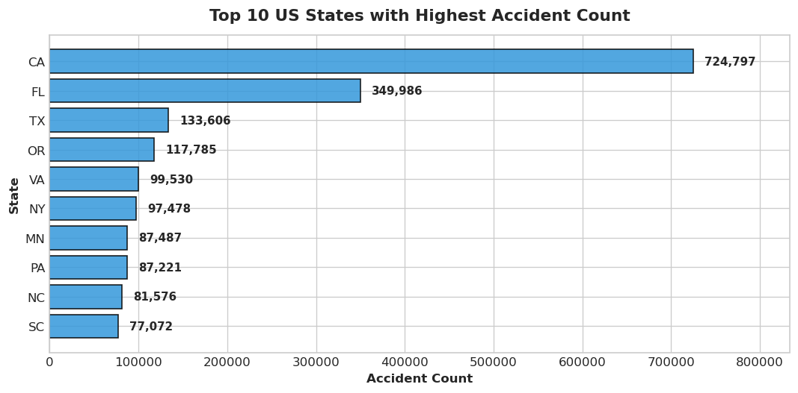 |
| 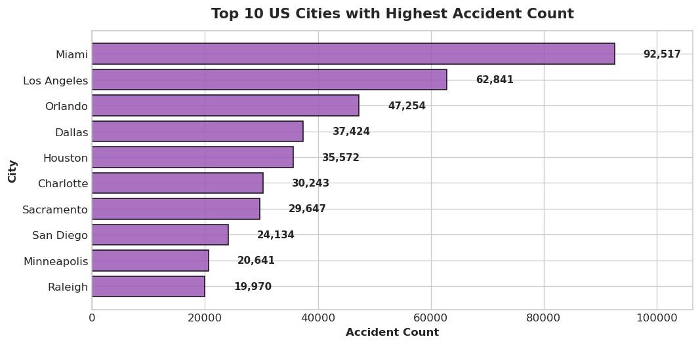 |
| 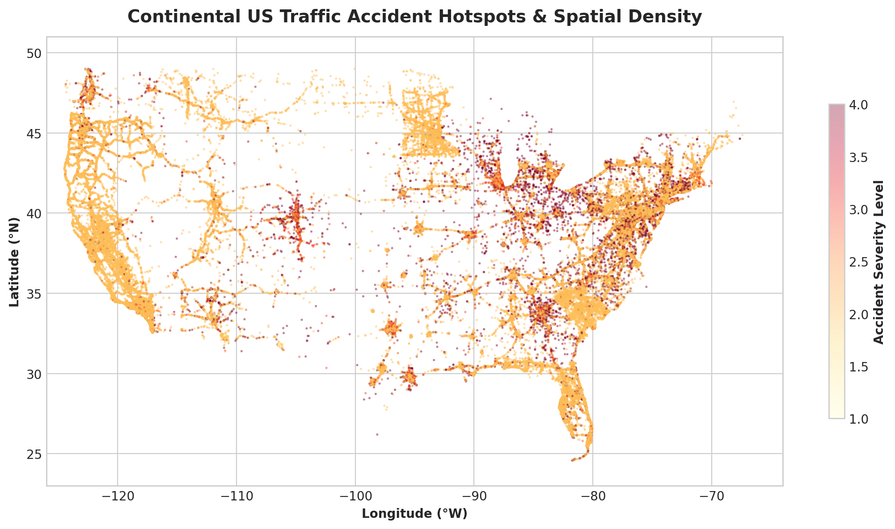 |

---

### 6. Correlation Analysis
The Pearson correlation heatmap shows weak linear correlation ($|r| < 0.05$) between individual scalar weather variables (temperature, humidity, pressure, visibility) and accident severity. Traffic collisions are multi-factorial events resulting from driver behavior, road layout, and congestion dynamics.

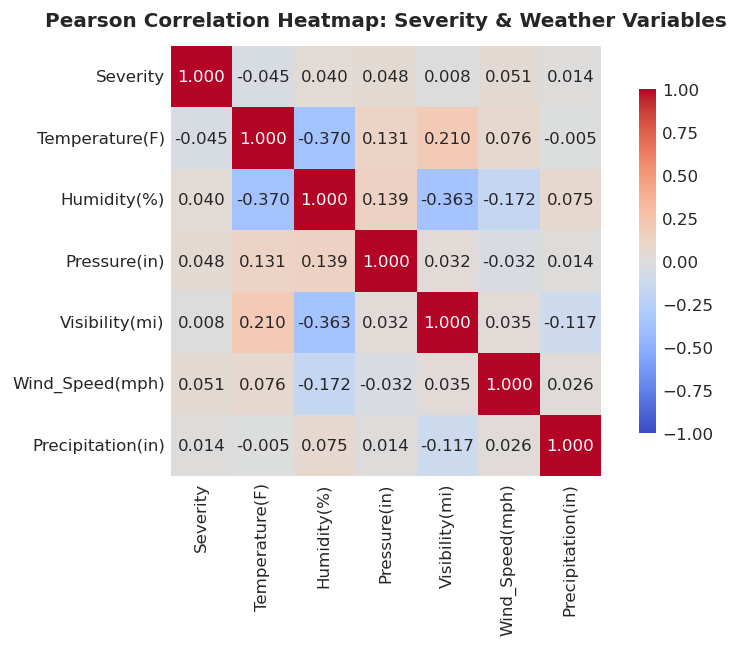

---

## 🛠️ Technologies & Libraries Used
- **Language:** Python 3.10+
- **Data Manipulation:** `pandas`, `numpy`
- **Data Visualization:** `matplotlib`, `seaborn`
- **Interactive Development:** `jupyter`, `notebook`, `nbconvert`

---

## 🚀 How to Run the Project

### 1. Clone the Repository
```bash
git clone https://github.com/your-username/TASK5_Traffic_Accident_EDA.git
cd TASK5_Traffic_Accident_EDA
```

### 2. Set Up Virtual Environment
```bash
# Create virtual environment
python -m venv .venv

# Activate on Windows
.venv\Scripts\activate

# Activate on macOS/Linux
source .venv/bin/activate
```

### 3. Install Dependencies
```bash
pip install -r requirements.txt
```

### 4. Launch Jupyter Notebook
```bash
jupyter notebook Task5_Traffic_Accident_EDA.ipynb
```

---

## 💡 Recommendations for Traffic Safety
1. **Intelligent Ramp Metering & Speed Throttling:** Deploy dynamic speed limit controls around highway junctions during peak evening hours (16:00–18:00).
2. **Intersection Geometry Improvements:** Redesign high-incident signalized intersections with dedicated left-turn signals and improved pedestrian refuge islands.
3. **Seasonal Warning Systems:** Implement real-time digital road signage during Q4 winter months (Nov–Dec) to alert drivers about reduced visibility and slick road conditions.
4. **Strategic Rapid Response Staging:** Station incident clearance teams and tow trucks near major metropolitan hot corridors (Miami, LA, Orlando, Dallas) during rush hours.

---

## 📜 License
This project is developed as part of the **CodeCraft InfoTech Data Science Internship** and is available under the [MIT License](LICENSE).

